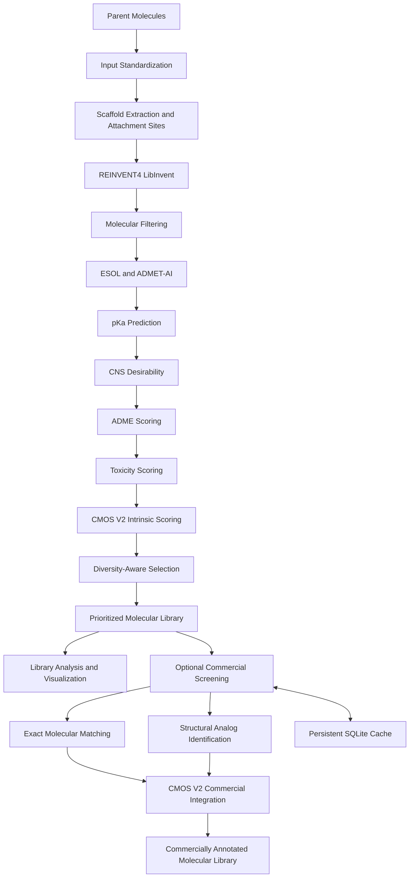

# REINVENT4 Scaffold Generator — V7


An integrated computational drug discovery platform for
scaffold-based molecular generation, molecular property prediction,
multiparameter optimization, diversity-aware compound selection,
and commercial compound screening.

The platform integrates REINVENT4 LibInvent with cheminformatics,
machine learning-based ADMET prediction, synthetic complexity
assessment, and configurable molecular optimization.

## Key Features

- Automated parent molecule standardization.
- Scaffold extraction and attachment-site design.
- REINVENT4 LibInvent molecular generation.
- Molecular validity and uniqueness filtering.
- Drug-likeness assessment using QED.
- Synthetic accessibility and synthetic complexity scoring.
- ESOL and ADMET-AI solubility prediction.
- Machine learning-based ADMET prediction.
- GPU-accelerated pKa prediction.
- CNS and blood-brain barrier desirability assessment.
- ADME and toxicity desirability scoring.
- Configurable multiparameter optimization.
- Diversity-aware molecular selection for each parent compound.
- Automated molecular library analysis and visualization.
- Local GPU and Slurm-based HPC execution.
- Commercial screening across eight enabled vendor libraries.
- Stereochemistry-aware exact molecular matching.
- ECFP-based structural analog identification.
- Persistent SQLite cache and interrupted-session recovery.
- Configurable commercial screening and remote submission limits.
- Commercial annotation of CMOS V2 selected molecules.

## Platform Architecture



## Installation

The platform uses three independent computational environments
to isolate dependencies.

| Environment | Function |
|---|---|
| reinvent4 | Molecular generation and optimization |
| admet_ai | ADMET and solubility prediction |
| cns_mpo | Molecular pKa prediction |

See the [Complete Installation Guide](docs/INSTALLATION.md)
for detailed setup instructions, external model acquisition,
CUDA compatibility and runtime configuration.

### Quick Start

Clone the repository:

```bash
git clone https://github.com/amir-tagh/REINVENT4-Scaffold-Generator.git
cd REINVENT4-Scaffold-Generator
```

Create the computational environments:

```bash
conda env create -f environments/reinvent4.yml
conda env create -f environments/admet_ai.yml
conda env create -f environments/cns_mpo.yml
```

Obtain the external pretrained models and apply the
LibInvent CUDA compatibility patch as described in the
installation guide.

Configure the runtime:

```bash
cp config/runtime.example.conf config/runtime.conf
```

The environment specifications were exported from the
working development environments. Fresh installation
and independent deployment remain to be validated.

## Input Format

Whitespace-delimited SMILES files contain a molecular SMILES
followed by an optional compound identifier.

```text
CC(=O)Oc1ccccc1C(=O)O Aspirin
CC(C)Cc1ccc(C(C)C(=O)O)cc1 Ibuprofen
```

The generation module also supports CSV input.

Public example molecules are provided in
[examples/example_hits.txt](examples/example_hits.txt).

## Execution

### Local GPU Execution

```bash
bash scripts/run_reinvent_v6.sh \
    examples/example_hits.txt \
    100 \
    results/example \
    cns \
    10
```

### HPC Execution

```bash
sbatch \
    --account=YOUR_ACCOUNT \
    --partition=YOUR_GPU_PARTITION \
    scripts/run_reinvent_v6.sh \
    examples/example_hits.txt \
    1000 \
    results/example_hpc \
    cns \
    30
```

Submit from the repository root.

| Argument | Description |
|---|---|
| 1 | Input molecular library |
| 2 | Target number of molecules per parent |
| 3 | Output directory |
| 4 | Optimization profile |
| 5 | Number of selected molecules per parent |

The target generation count is not guaranteed for every scaffold.

## Computational Modules

| Module | Function |
|---|---|
| scripts/scaffold_libinvent_v5_devicefix.py | Scaffold-based molecular generation |
| scripts/cumulative_score.py | Legacy CMOS V1 scoring used by the generation module |
| scripts/molecular_admet.py | ESOL and ADMET-AI prediction |
| scripts/molecular_pka.py | GPU-accelerated pKa prediction |
| scripts/molecular_cns.py | CNS desirability scoring |
| scripts/molecular_adme.py | ADME desirability scoring |
| scripts/molecular_toxicity.py | Toxicity desirability scoring |
| scripts/cumulative_score_v2.py | CMOS V2 optimization and selection |
| scripts/run_reinvent_v6.sh | Integrated computational workflow |
| analysis/analyze_reinvent_comprehensive.py | Comprehensive library analysis |
| analysis/analyze_reinvent_rgroups_v5.py | R-group analysis |
| analysis/compare_cmos_versions.py | CMOS benchmarking |
| analysis/plot_cmos_benchmark.py | Benchmark visualization |

## Cumulative Molecular Optimization Score (CMOS V2)

CMOS V2 integrates ten molecular optimization components.

| Component | Default CNS weight |
|---|---:|
| Drug-likeness (QED) | 10% |
| Synthetic accessibility | 10% |
| Synthetic complexity | 10% |
| Parent molecular similarity | 10% |
| Structural diversity | 15% |
| Solubility | 10% |
| CNS desirability | 10% |
| Blood-brain barrier desirability | 5% |
| ADME desirability | 5% |
| Toxicity desirability | 15% |
| **Total** | **100%** |

Intrinsic molecular desirability is calculated from the
non-diversity components. Structural diversity is incorporated
during greedy, per-parent compound selection using Morgan
fingerprints and Tanimoto similarity.

CMOS V2 is a post-generation prioritization framework,
not a reinforcement learning reward function.

### Optimization Profiles

| Profile | Application |
|---|---|
| cns | CNS-oriented molecular optimization |
| cns_safety | Safety-oriented CNS optimization |
| general | General molecular optimization |
| oral | Oral drug discovery |
| experimental | Experimental compound prioritization |

The default cns and cns_safety profiles currently use
identical weights.

Profiles and sensitivity configurations are defined in:

- [Optimization profiles](config/optimization_profiles.json)
- [CNS sensitivity profiles](config/cns_sensitivity_profiles.json)

See the [CMOS Documentation](docs/CMOS_DOCUMENTATION.md)
for additional methodological details.


## V7 Commercial Compound Screening

V7 extends the original V6 workflow with commercial catalog
screening through SwissSimilarity.

Supported commercial libraries:

- Enamine
- ChemBridge
- ChemDiv
- Life Chemicals
- Maybridge
- SPECS
- Asinex
- Otava

The default profile uses Enamine and ChemBridge.

### Full V7 Pipeline

    bash scripts/run_reinvent_v7.sh full examples/example_hits.txt 100 results/v7/example cns 10

### Commercial-Only Screening

    bash scripts/run_reinvent_v7.sh commercial-only results/example/cmos/CMOS_V2_selected.csv results/v7/commercial --libraries Enamine ChemBridge

### Remote Screening

    bash scripts/run_reinvent_v7.sh commercial-only tests/commercial_screening/mock_cmos.csv results/v7/remote --libraries Enamine --allow-remote --maximum-new-jobs 1

Remote submissions are disabled by default.

V7 preserves the original CMOS V2 scores and selection rankings
and adds 21 commercial screening annotations.

The original V7 implementation was validated on HyperGator
through offline, controlled live, recovery, full pipeline,
and data integrity tests.

The portable launcher has passed Bash syntax validation.
Independent end-to-end deployment remains unvalidated.

See the [Commercial Screening Documentation](docs/COMMERCIAL_SCREENING.md)
for detailed configuration, usage, outputs, and limitations.

## Repository Structure

```text
REINVENT4-Scaffold-Generator/
├── scripts/
│   ├── run_reinvent_v6.sh
│   ├── run_reinvent_v7.sh
│   ├── commercial/
│   ├── scaffold_libinvent_v5_devicefix.py
│   ├── cumulative_score.py
│   ├── cumulative_score_v2.py
│   ├── molecular_admet.py
│   ├── molecular_pka.py
│   ├── molecular_cns.py
│   ├── molecular_adme.py
│   └── molecular_toxicity.py
├── analysis/
│   ├── analyze_reinvent_comprehensive.py
│   ├── analyze_reinvent_rgroups_v5.py
│   ├── compare_cmos_versions.py
│   └── plot_cmos_benchmark.py
├── config/
│   ├── commercial_sources.json
│   ├── optimization_profiles.json
│   ├── cns_sensitivity_profiles.json
│   └── runtime.example.conf
├── environments/
│   ├── reinvent4.yml
│   ├── admet_ai.yml
│   └── cns_mpo.yml
├── patches/
│   ├── libinvent_cuda_device.patch
│   └── patch_morgan_generator.py
├── examples/
│   └── example_hits.txt
├── tests/
│   └── commercial_screening/
├── docs/
│   ├── COMMERCIAL_SCREENING.md
│   ├── INSTALLATION.md
│   ├── CMOS_DOCUMENTATION.md
│   ├── README_V3.md
│   └── images/
├── legacy/
├── CITATION.cff
├── THIRD_PARTY_NOTICES.md
├── LICENSE
└── README.md
```

## Output Files

The integrated workflow produces:

```text
results/example/
├── generation/
├── admet/
├── cmos/
│   ├── CMOS_V2.csv
│   ├── CMOS_V2_selected.csv
│   ├── CMOS_V2_selected.smi
│   └── CMOS_V2.summary.json
├── optimization_profiles.json
└── Final_Property_Comparison.csv
```

The selected CSV contains molecular structures,
predicted properties, optimization scores and selection ranks.

The selected SMILES file provides the prioritized molecular
library for downstream computational and experimental studies.

## Validation and Reproducibility

The original V6 computational workflow was executed on
the University of Florida HyperGator HPC infrastructure.

The repository provides:

- Exported computational environment specifications.
- Configurable runtime and optimization parameters.
- A version-specific LibInvent CUDA compatibility patch.
- Automated library analysis and benchmarking modules.
- Public example molecular inputs.

The reorganized portable launcher has passed Bash syntax
validation. Independent end-to-end deployment, fresh
environment installation and the public example runs
have not yet been validated.

## Limitations

- Predicted molecular properties require experimental validation.
- RNA binding affinity is not currently an optimization objective.
- Predicted pKa is excluded from active CMOS V2 optimization.
- Synthetic accessibility does not establish synthetic feasibility.
- Commercial catalog matches do not establish current stock availability.
- Absence of returned exact matches does not establish catalog absence.
- Large-scale remote screening and concurrency remain unvalidated.
- CPU-only execution has not been validated.
- Diversity-aware selection is performed per parent molecule.
- Global uniqueness across different parent selections is not guaranteed.

Proprietary molecular structures, unpublished benchmark
results, pretrained model weights and computational outputs
are not distributed with this repository.

## Documentation

- [Installation Guide](docs/INSTALLATION.md)
- [CMOS Methodology](docs/CMOS_DOCUMENTATION.md)
- [Commercial Screening](docs/COMMERCIAL_SCREENING.md)
- [Historical V3 Documentation](docs/README_V3.md)
- [Legacy Code](legacy/README.md)
- [Third-Party Notices](THIRD_PARTY_NOTICES.md)

## Citation

Citation metadata is available in [CITATION.cff](CITATION.cff).

Please also cite the original publications associated with
REINVENT4, RDKit, SCScore, ADMET-AI and other external methods
used in your research.

## License

The original repository software is distributed under the
[MIT License](LICENSE).

External software and pretrained models remain subject to
their respective upstream licensing requirements.

See [Third-Party Notices](THIRD_PARTY_NOTICES.md).
