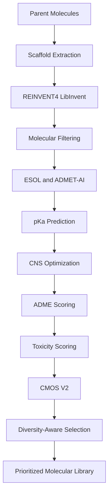

# REINVENT4 Scaffold Generator — V6

An integrated platform for scaffold-based molecular generation,
ADMET prediction, multiparameter optimization, and
diversity-aware compound selection.

## Platform Architecture



## Main Modules

| Module | Function |
|---|---|
| scaffold_libinvent_v5_devicefix.py | Molecular generation |
| molecular_admet.py | ESOL and ADMET-AI prediction |
| molecular_pka.py | GPU-accelerated pKa prediction |
| molecular_cns.py | CNS desirability |
| molecular_adme.py | ADME optimization |
| molecular_toxicity.py | Toxicity desirability |
| cumulative_score_v2.py | Multiparameter optimization |
| compare_cmos_versions.py | CMOS benchmarking |
| plot_cmos_benchmark.py | Benchmark visualization |
| run_reinvent_v6.sh | Integrated Slurm workflow |

## Repository Structure

- scripts/ — generation, optimization and analysis.
- config/ — optimization and sensitivity profiles.
- docs/ — documentation and workflow graphics.

## Execution

The computational workflow is validated on HyperGator
using separate REINVENT4, ADMET-AI and CNS MPO environments.

```bash
sbatch scripts/run_reinvent_v6.sh \
    inputs/example_hits.txt \
    1000 \
    results/v6/example_run \
    cns \
    30
```

Review environment paths, model locations and Slurm
configuration before deployment on another system.

## Optimization Profiles

CMOS V2 integrates drug-likeness, synthetic accessibility,
synthetic complexity, parent similarity, structural diversity,
solubility, CNS, BBB, ADME and toxicity desirability.

Profiles are configurable through:

- config/optimization_profiles.json
- config/cns_sensitivity_profiles.json

## Documentation

- [CMOS Documentation](CMOS_DOCUMENTATION.md)
- [Original V3 Documentation](docs/README_V3.md)

## Limitations

- CMOS performs post-generation optimization.
- RNA binding affinity is not currently included.
- ADMET predictions require experimental validation.
- Predicted pKa is excluded from active CMOS optimization.
- Commercial availability is not yet verified.
- The validated REINVENT4 environment includes a local
  LibInvent CUDA device-alignment modification.

Proprietary molecular structures, unpublished benchmark
results, model weights and computational outputs are
not distributed with this repository.
