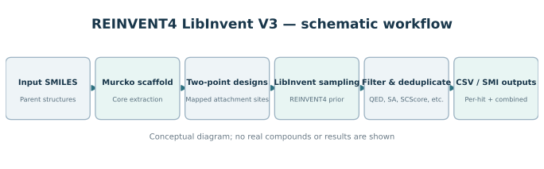
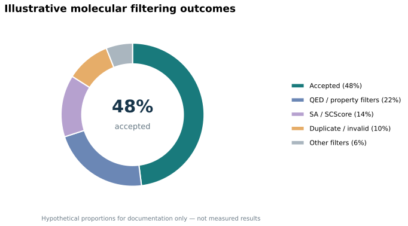
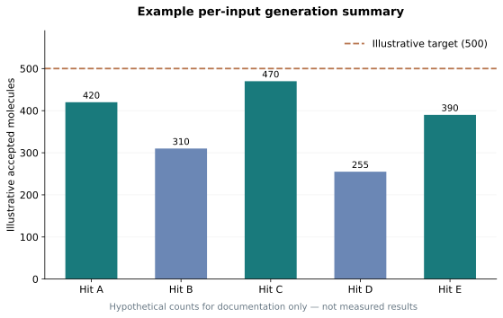

# REINVENT4 Scaffold Generator — LibInvent V3

Scaffold-guided small-molecule analogue generation using **REINVENT4 LibInvent**, RDKit scaffold analysis, configurable physicochemical and medicinal-chemistry filters, and a multi-hit Slurm batch workflow.

> **Stable workflow:** `scaffold_libinvent_v3.py` and `run_multiple_hits_v3.sh`. Experimental V4/V5 implementations are not part of this documented release.



## What the pipeline does

1. Read one or more parent SMILES and extract Bemis–Murcko scaffolds with RDKit.
2. Rank eligible attachment positions and create **two-point** LibInvent scaffold designs.
3. Sample new molecules from the installed REINVENT4 LibInvent prior, across designs and rounds.
4. Validate structures, calculate descriptors, apply configured filters, and remove duplicates.
5. Write per-input molecular libraries and, with the Slurm wrapper, a globally deduplicated combined library.

**Important:** This is ligand/scaffold-based generation, not RNA/protein structure-guided optimization. Attachment-site ranking is heuristic and does not predict binding affinity, pocket accessibility, or synthetic feasibility.

## Requirements

- Working REINVENT4 installation and `priors/libinvent.prior` model.
- Python environment with RDKit and the dependencies required by `scaffold_libinvent_v3.py`.
- Optional/locally configured SCScore model for SCScore filtering; the V3 Slurm wrapper specifies a local model path.
- Slurm with a GPU allocation for `run_multiple_hits_v3.sh` (the included batch directives are specific to the original HyperGator configuration).

Run from the **REINVENT4 installation directory**, where relative prior and SCScore paths resolve, and ensure the two V3 scripts are available there. Review the hard-coded environment, account, partition, and model paths in the Slurm wrapper before running on another system.

## Quick start

### Single parent molecule

```bash
python scaffold_libinvent_v3.py \
  --smiles 'Cc1ccccc1' \
  --num-molecules 100 \
  --model priors/libinvent.prior \
  --out example_single
```

### Multiple parent molecules on Slurm

Create a plain-text file such as `example_hits.txt` with **identifier first, SMILES second** (one entry per line):

```text
Hit_A Cc1ccccc1
Hit_B CCc1ccccc1
```

Then submit:

```bash
sbatch run_multiple_hits_v3.sh example_hits.txt 500 example_batch
```

The positional arguments are: `input_file`, `target_molecules_per_input` (default 1000), and `output_directory` (default `REINVENT_V3_Results`). Additional Python options can be appended after these arguments. The wrapper uses the LibInvent prior and configured default filters, including QED ≥ 0.7, SA ≤ 4.0, and SCScore ≤ 3.5 when its SCScore model is available.

**Input format distinction:** the V3 batch wrapper reads `ID SMILES` or a single `SMILES` per line. The single-molecule Python script also supports its own `--input` / CSV options; consult `python scaffold_libinvent_v3.py --help` for the complete argument list.

**Target counts are not guaranteed.** Generation may produce fewer molecules than requested if valid unique structures cannot be obtained within the configured sampling rounds. Use a **new or empty output directory** for each run.

## Outputs

```text
example_batch/
├── batch_settings.json
├── overall_summary.csv
├── combined_generated.csv
├── combined_unique_generated.csv
├── combined_unique_generated.smi
└── 0001_Hit_A/
    ├── inputs.csv
    ├── candidates.csv
    ├── designs.csv
    ├── generated.csv
    └── runs/
        └── ... (sampling configurations, outputs and logs)
```

Each parent gets a separate output directory. The combined files retain parent provenance; `combined_unique_generated.csv` and `.smi` consolidate duplicate structures across parent runs. The pipeline may also write diagnostic or additional per-input files, depending on options and available dependencies.

| File | Purpose |
|---|---|
| `inputs.csv` | Validated inputs and extracted scaffolds |
| `candidates.csv` | Candidate attachment sites and heuristic ranking |
| `designs.csv` | Selected two-point mapped scaffold designs |
| `generated.csv` | Accepted generated molecules, provenance and descriptors |
| `overall_summary.csv` | Requested versus accepted counts and run status by parent |
| `combined_generated.csv` | Combined per-parent records |
| `combined_unique_generated.csv` | Globally deduplicated structures with parent provenance |
| `combined_unique_generated.smi` | Globally unique SMILES library |
| `runs/` | Per-design REINVENT4 sampling configurations and logs |

## Illustrative output graphics

The following graphics use **hypothetical numbers only** to demonstrate how generation results could be summarized. **They are not output from any actual run and do not represent real molecules or experimental measurements.**

### Example filtering outcomes



The donut chart is a schematic distribution of accepted and filtered structures; actual filter categories may overlap, and this graphic should not be interpreted as a measured or mutually exclusive rejection breakdown.

### Example per-parent summary



A hypothetical comparison of accepted molecules against a requested target; real counts are recorded in `overall_summary.csv`.

## How attachment points are selected

RDKit extracts Bemis–Murcko scaffolds. Eligible positions include scaffold atoms with available hydrogens and, where enabled, atoms bearing substituents in the input. Original side chains are not necessarily retained: the scaffold is used as a core with variable R-groups. The pipeline ranks candidate sites using heuristics such as existing substituent positions, site frequency, and atom type, and selects two positions for each design.

If fewer than two eligible sites exist, that scaffold may be skipped. Unrelated parents are not forced to share a single scaffold.

## Limitations and reproducibility

- The configured LibInvent prior expects **two attachment points** per design.
- Bemis–Murcko scaffolds can be overly minimal; inspect `designs.csv` and generated chemistry critically.
- Property and alert filters are prioritization heuristics, not proof of bioactivity, selectivity, or synthesizability.
- The REINVENT4 CLI is invoked for sampling rounds; this V3 workflow is not a persistent in-memory GPU sampler.
- Keep `batch_settings.json`, REINVENT4 version, prior checkpoint, filter settings, and logs alongside results for reproducibility.
- The Slurm wrapper uses environment-specific paths and must be adapted before use elsewhere.

## Repository graphics

Editable SVG versions and PNG previews are in `images/`. All examples are synthetic documentation illustrations; no proprietary compound structures or experimental results are included.

## CMOS Molecular Scoring

The V5 pipeline includes automatic cumulative molecular scoring and diversity-aware compound selection. See [CMOS Documentation](CMOS_DOCUMENTATION.md) for methodology, integration, and validation.
